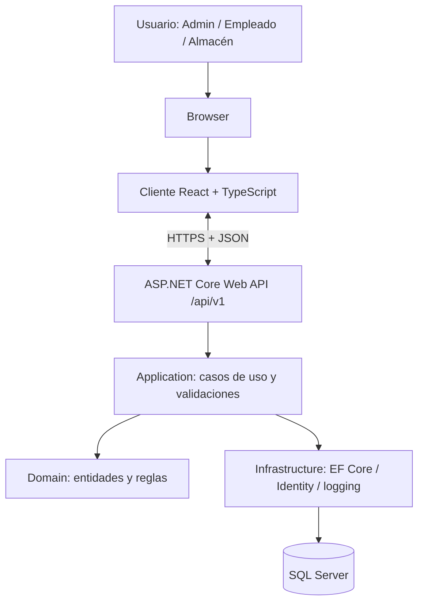
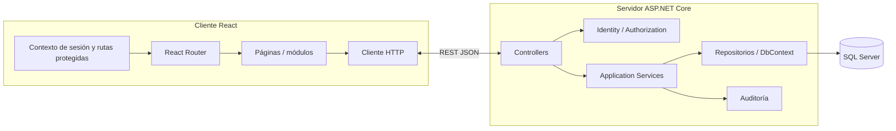
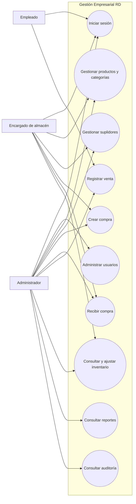
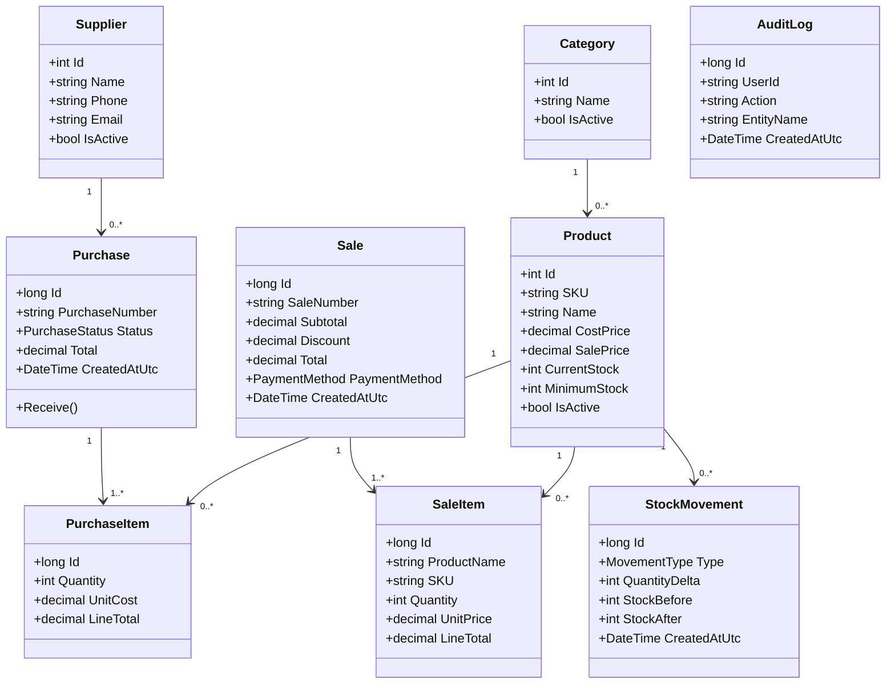
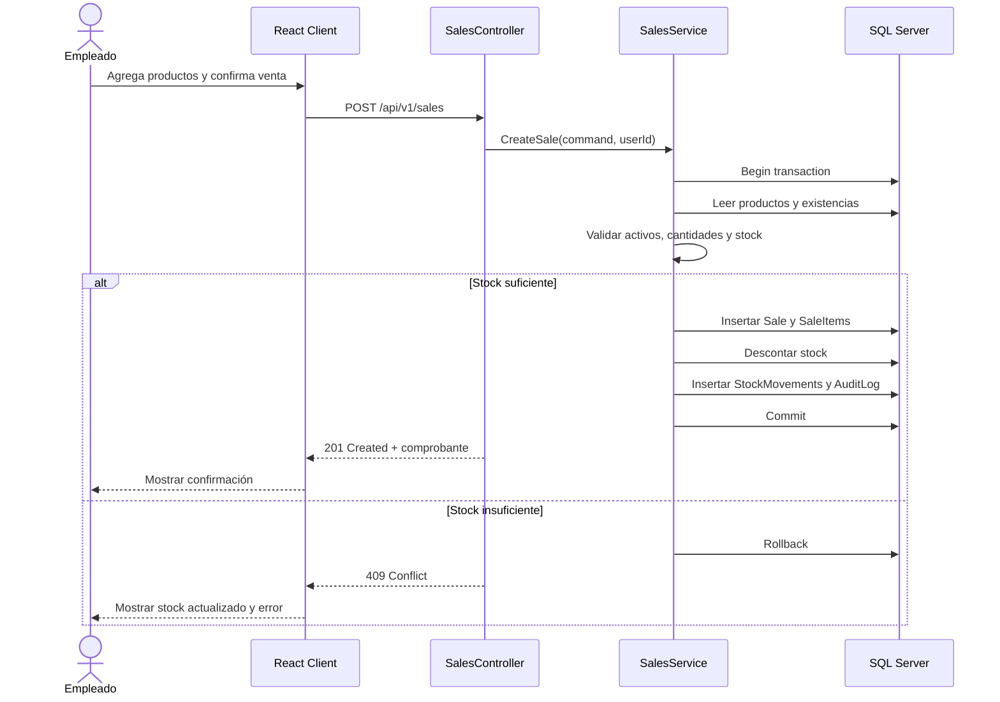

# 4 y 5. Modelado y arquitectura de software

## 4.1 Estilo arquitectónico

Se adopta **cliente-servidor con monolito modular en el backend y arquitectura por capas**. React se despliega como cliente independiente; ASP.NET Core Web API atiende solicitudes HTTP y ejecuta reglas de negocio; SQL Server conserva los datos.

No se eligen microservicios porque el alcance es un único comercio, un equipo académico pequeño y un prototipo de una sola base de datos. Los módulos internos mantienen límites claros para permitir una separación futura si existe una necesidad real.

## 4.2 Diagrama de arquitectura cliente-servidor



## 4.3 Diagrama de componentes



## 4.4 Diagrama de casos de uso



## 4.5 Diagrama de clases (modelo de dominio simplificado)



## 4.6 Diagrama de secuencia: registrar venta



## 4.7 Módulos del sistema

1. Identity & Access: sesión, perfil, usuarios, roles.
2. Catalog: categorías y productos.
3. Suppliers: suplidores.
4. Purchasing: compras, líneas y recepción.
5. Sales: ventas, líneas y comprobantes internos.
6. Inventory: existencias, movimientos, ajustes y alertas.
7. Reporting: dashboard y reportes.
8. Audit: registro de operaciones sensibles.

## 4.8 Organización de carpetas recomendada

```text
src/
  backend/
    GestionEmpresarial.sln
    src/
      GestionEmpresarial.Domain/
        Common/                 # Entity base, errores de dominio
        Entities/               # Product, Category, Supplier, Sale...
        Enums/                  # Status, MovementType, PaymentMethod
        ValueObjects/           # Money si se decide implementarlo
      GestionEmpresarial.Application/
        Abstractions/           # interfaces de persistencia/servicios
        Common/                 # Result, paginación, current user
        Features/
          Auth/
          Users/
          Categories/
          Products/
          Suppliers/
          Purchases/
          Sales/
          Inventory/
          Reports/
        Validation/
      GestionEmpresarial.Infrastructure/
        Persistence/            # DbContext, mappings, migrations, seed
        Identity/               # Identity user, roles y configuración
        Repositories/
        Services/
        Auditing/
      GestionEmpresarial.Api/
        Controllers/
        Middleware/
        Contracts/              # Requests/Responses de HTTP si aplica
        Extensions/              # DI, OpenAPI, CORS, auth
        Program.cs
    tests/
      GestionEmpresarial.UnitTests/
      GestionEmpresarial.IntegrationTests/
  frontend/
    src/
      app/                      # Router, providers, configuración
      shared/
        api/                    # Cliente HTTP e interceptores
        components/             # Botones, tabla, modal, campos
        hooks/
        layouts/
        types/
        utils/
      features/
        auth/
        dashboard/
        users/
        categories/
        products/
        suppliers/
        purchases/
        sales/
        inventory/
        reports/
```

## 4.9 Convenciones API

- Base URL: `/api/v1`.
- JSON camelCase; enums documentados como strings.
- Listados: `page`, `pageSize`, `search`, `sortBy`, `sortDirection` con límites.
- Respuesta de error: Problem Details, sin detalles internos.
- `POST` que crea recurso responde 201 y ubicación; errores de conflicto usan 409.
- Nunca exponer entidades EF directamente; utilizar DTOs.

### Endpoints previstos

| Método | Ruta | Acceso | Uso |
|---|---|---|---|
| POST | `/api/v1/auth/login` | Público | Iniciar sesión |
| POST | `/api/v1/auth/logout` | Autenticado | Cerrar sesión |
| GET | `/api/v1/auth/me` | Autenticado | Perfil y roles |
| GET/POST | `/api/v1/users` | Admin | Listar/crear usuarios |
| PUT | `/api/v1/users/{id}` | Admin | Editar/desactivar usuario |
| GET/POST | `/api/v1/categories` | Admin/Almacén | Consultar/crear categorías |
| PUT | `/api/v1/categories/{id}` | Admin/Almacén | Editar categoría |
| GET/POST | `/api/v1/products` | Autenticado / Admin/Almacén para crear | Consultar/crear productos |
| GET/PUT | `/api/v1/products/{id}` | Autenticado / Admin/Almacén para editar | Detalle/edición |
| GET/POST | `/api/v1/suppliers` | Admin/Almacén | Suplidores |
| GET/POST | `/api/v1/purchases` | Admin/Almacén | Listar/crear borrador |
| POST | `/api/v1/purchases/{id}/receive` | Admin/Almacén | Recibir compra |
| GET | `/api/v1/sales` | Admin; empleado según alcance | Consultar ventas |
| POST | `/api/v1/sales` | Admin/Empleado | Registrar venta |
| GET | `/api/v1/inventory/movements` | Admin/Almacén | Historial |
| POST | `/api/v1/inventory/adjustments` | Admin/Almacén | Ajustar stock |
| GET | `/api/v1/inventory/low-stock` | Admin/Almacén | Alertas |
| GET | `/api/v1/reports/dashboard` | Admin | Indicadores |
| GET | `/api/v1/reports/sales` | Admin | Reporte de ventas |
| GET | `/api/v1/audit-logs` | Admin | Auditoría |

Los permisos concretos deben configurarse en backend con políticas/roles y probarse. Una tabla de endpoints no sustituye la autorización real.
