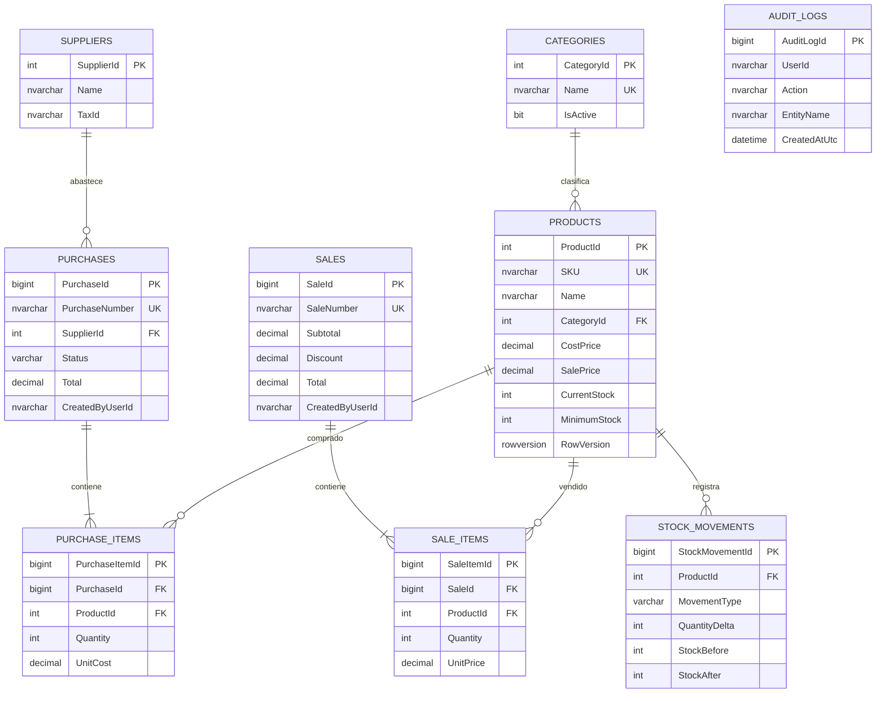

# 6. Diseño de base de datos

## 6.1 Convenciones

- SQL Server; esquema `dbo`.
- Claves sustitutas identity para tablas transaccionales/catalogales.
- `DECIMAL(18,2)` para dinero, moneda DOP.
- `DATETIME2` en UTC.
- Soft delete (`IsActive`) para catálogos que pueden estar referenciados históricamente.
- No borrar ventas ni compras recibidas.
- La seguridad/identidad se implementa con ASP.NET Core Identity y sus tablas `AspNetUsers`, `AspNetRoles`, etc. Las columnas `CreatedByUserId`/`UserId` almacenan el identificador de Identity.

## 6.2 Entidades

| Tabla | Propósito | Clave/relaciones |
|---|---|---|
| Categories | Clasificación de productos | PK CategoryId; 1:N Products |
| Products | Catálogo y balance actual | PK ProductId; FK CategoryId; SKU único; RowVersion |
| Suppliers | Suplidores | PK SupplierId; 1:N Purchases |
| Purchases | Encabezado de compra | PK PurchaseId; FK SupplierId; PurchaseNumber único |
| PurchaseItems | Líneas de compra | PK PurchaseItemId; FK PurchaseId, ProductId |
| Sales | Encabezado de venta | PK SaleId; SaleNumber único; usuario creador |
| SaleItems | Líneas históricas de venta | PK SaleItemId; FK SaleId, ProductId; copia nombre/SKU/precio |
| StockMovements | Trazabilidad de entradas/salidas/ajustes | PK StockMovementId; FK ProductId |
| AuditLogs | Auditoría de acciones sensibles | PK AuditLogId; actor, acción, entidad y fecha |

## 6.3 Relaciones

## 6.4 Normalización e integridad

- Categories, Products y Suppliers son entidades independientes para evitar repetir datos descriptivos.
- PurchaseItems y SaleItems resuelven relaciones 1:N desde encabezados a líneas.
- Las cantidades y precios históricos quedan en las líneas transaccionales; una modificación posterior del catálogo no cambia una venta ya registrada.
- Las claves foráneas evitan líneas huérfanas. Los campos `CreatedByUserId`/`UserId` deben mapearse en EF Core a `AspNetUsers.Id` con borrado restringido (`Restrict`/`NoAction`); el DDL de referencia no crea esa FK porque las tablas Identity se generan por migración.
- SKU, número de compra y número de venta son únicos.
- Restricciones CHECK prohíben precios, cantidades, descuentos o existencias negativas.
- `RowVersion` permite detectar escrituras concurrentes sobre el producto.
- `StockMovements` da trazabilidad; `Products.CurrentStock` es balance materializado para consultas rápidas y debe actualizarse en la misma transacción.

## 6.5 Reglas transaccionales

### Venta

1. Abrir transacción.
2. Leer productos activos y existencias actuales.
3. Validar cantidad solicitada y stock.
4. Calcular precios/totales en servidor.
5. Crear Sales y SaleItems.
6. Actualizar Products.CurrentStock.
7. Insertar StockMovements.
8. Insertar AuditLogs.
9. Confirmar transacción.

Si cualquier paso falla, ejecutar rollback. Manejar conflicto de concurrencia y devolver 409.

### Recepción de compra

1. Abrir transacción y cargar compra con sus líneas.
2. Verificar `Status == Draft`.
3. Cambiar estado a `Received`.
4. Incrementar stock por línea.
5. Crear movimientos y auditoría.
6. Confirmar transacción.

La segunda llamada debe devolver 409 y no duplicar existencias.

## 6.6 Índices recomendados

- Unique: Products(SKU), Categories(Name), Purchases(PurchaseNumber), Sales(SaleNumber).
- Products(CategoryId), Products(Name), Products(CurrentStock, MinimumStock) filtrado a IsActive=1.
- Sales(CreatedAtUtc), SaleItems(ProductId), Purchases(SupplierId, CreatedAtUtc), StockMovements(ProductId, CreatedAtUtc), AuditLogs(CreatedAtUtc).

## 6.7 Script

Revisar `database/scripts/01-create-database.sql`. Es un DDL de referencia académica. En el desarrollo real, las migraciones de EF Core deben mantener sincronizados los modelos y el esquema.
