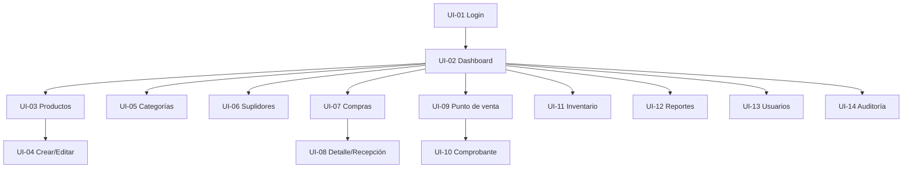

# 7. Diseño de interfaces y prototipos

Este documento sirve como especificación para construir los wireframes en Figma y luego implementarlos en React. Los prototipos deben ser imágenes/capturas identificadas como **diseño propuesto**, mientras que las capturas del sistema ejecutándose deben identificarse como **pantalla implementada**.

## 13.1 Principios de interfaz

- Interfaz en español y moneda DOP.
- Diseño web adaptable a computadora, tablet y móvil (ancho mínimo objetivo: 360 px).
- Navegación consistente con menú lateral en escritorio y menú compacto en móvil.
- Formularios con etiquetas visibles, validación, mensajes de error y confirmación.
- Tablas con búsqueda, filtros, paginación y estados vacíos/cargando/error.
- Acciones críticas (recibir compra, confirmar venta, ajustar stock) requieren confirmación explícita.
- Mostrar claramente el rol y las opciones permitidas, sin utilizar el frontend como sustituto de la autorización del servidor.

## 13.2 Inventario de pantallas requeridas

| Código | Pantalla | Componentes mínimos | Acción principal |
|---|---|---|---|
| UI-01 | Inicio de sesión | Email, contraseña, mostrar contraseña, error y botón | Autenticarse |
| UI-02 | Dashboard | Ventas del día, número de ventas, productos bajos, top productos y filtro de período | Consultar resumen |
| UI-03 | Productos | Tabla, búsqueda, filtro categoría/estado, paginación | Consultar/gestionar catálogo |
| UI-04 | Crear/editar producto | SKU, nombre, descripción, categoría, costo, precio, stock mínimo | Guardar producto |
| UI-05 | Categorías | Tabla, formulario y estado | Gestionar categorías |
| UI-06 | Suplidores | Tabla, búsqueda, formulario de datos | Gestionar suplidor |
| UI-07 | Compras | Listado con estado, suplidor, fecha y total | Crear/abrir compra |
| UI-08 | Detalle de compra | Suplidor, líneas, cantidades, costos, subtotal/total, estado | Recibir compra |
| UI-09 | Punto de venta | Buscador, carrito, cantidad, método de pago, subtotal, descuento y total | Confirmar venta |
| UI-10 | Comprobante interno | Número, fecha, empleado, líneas, subtotal y total | Imprimir/volver |
| UI-11 | Inventario | Stock actual, mínimo, alertas, movimientos y filtros | Consultar/ajustar |
| UI-12 | Reportes | Rango de fecha, indicadores, tabla y gráficos | Consultar reporte |
| UI-13 | Usuarios | Tabla de usuarios, rol y estado; formulario | Crear/editar usuario |
| UI-14 | Auditoría | Tabla de actor, acción, entidad, fecha y filtros | Revisar eventos |

## 13.3 Estructura de navegación sugerida



## 13.4 Wireframes de baja fidelidad

### UI-01 Login

```text
+--------------------------------------+
|          GESTIÓN EMPRESARIAL RD      |
|                                      |
|          Correo electrónico          |
|          [____________________]      |
|          Contraseña                  |
|          [____________________]      |
|                                      |
|              [ INICIAR SESIÓN ]      |
|          Mensaje de validación       |
+--------------------------------------+
```

### UI-02 Dashboard

```text
+---------------------------------------------------------+
| LOGO | Dashboard                  Usuario / Rol | Salir |
+-------------+-------------------------------------------+
| Menú        | [Ventas hoy] [Nº ventas] [Stock bajo]     |
| Dashboard   |                                           |
| Productos   | [Filtro de período: Desde / Hasta]       |
| Compras     |                                           |
| Ventas      | [Gráfico de ventas] [Top productos]       |
| Inventario  |                                           |
| Reportes    | [Tabla de alertas de stock bajo]          |
| Usuarios    |                                           |
+-------------+-------------------------------------------+
```

### UI-09 Punto de venta

```text
+---------------------------------------------------------+
| Punto de venta                                          |
| Buscar producto [________________________] [Agregar]     |
|---------------------------------------------------------|
| Producto              Precio      Cantidad      Importe |
| Agua 500ml            DOP 20.00       2         DOP 40  |
| Galletas              DOP 25.00       1         DOP 25  |
|---------------------------------------------------------|
| Subtotal: DOP 65.00     Descuento: [0.00]               |
| Método de pago: (Efectivo / Tarjeta / Transferencia)    |
| TOTAL: DOP 65.00                                        |
|                     [CONFIRMAR VENTA]                  |
+---------------------------------------------------------+
```

Los wireframes son estructura funcional inicial, no diseño gráfico final. El equipo debe producir en Figma versiones visuales con componentes y jerarquía consistentes.

## 13.5 Entregables de diseño

- Enlace al archivo Figma o exportación PDF/PNG de los wireframes.
- Prototipos de UI-01, UI-02, UI-03, UI-04, UI-08, UI-09 y UI-11 como mínimo.
- Capturas reales de las pantallas implementadas.
- Tabla breve que relacione prototipo, requisito funcional y módulo React.
